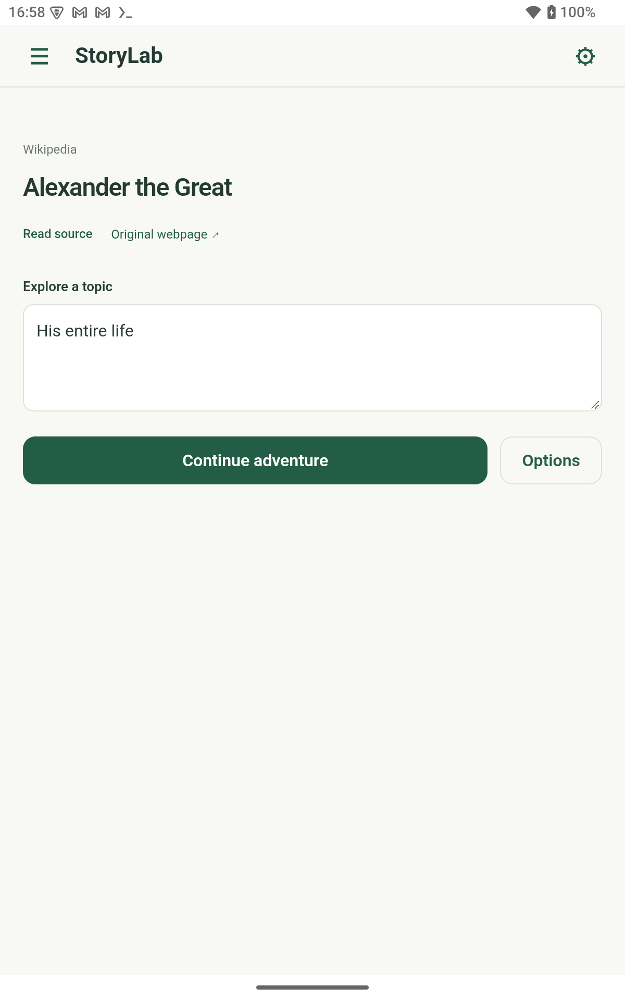
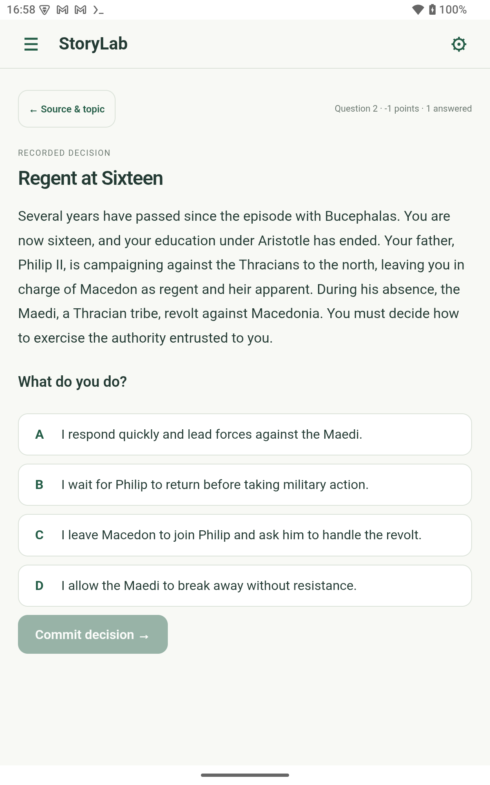
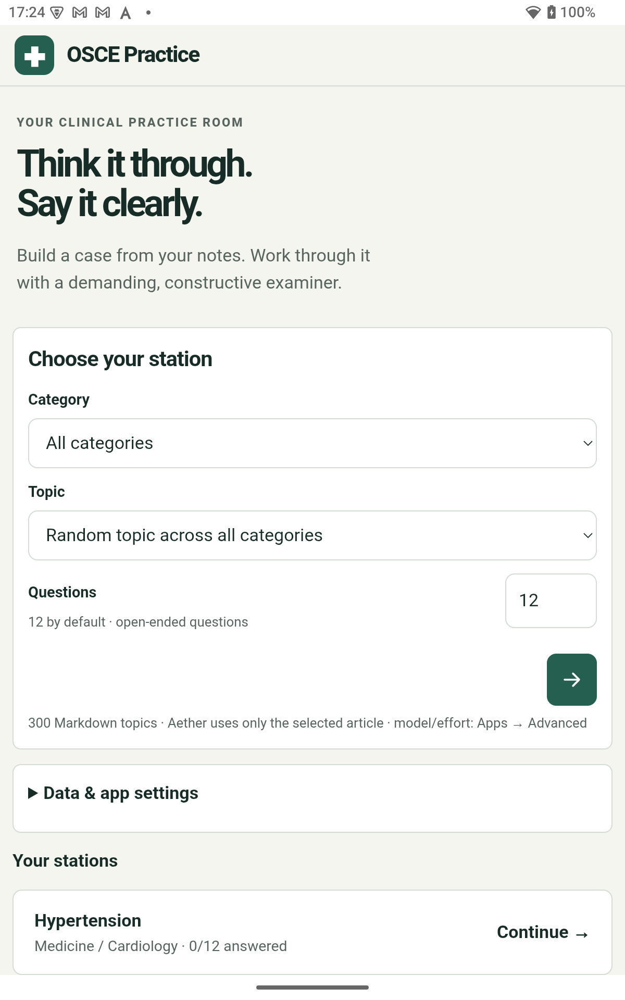

# Aether web apps

Editable app sources for Aether. The independently installed [Apps extension](https://github.com/josephm1/aether-apps) owns project management, permissions and the SDK. Native Android hosting requires [Aether host support](https://github.com/josephm1/aether-host-support/tree/review/web-app-host), pending upstream review. iOS native hosting is not implemented.

| Project | Purpose | Build |
| --- | --- | --- |
| `web-app-projects/storylab` | Source-grounded narrative decisions and learning challenges | `npm test`; `npm run build` |
| `web-app-projects/learnharness` | Adapted learning harness | `npm ci --ignore-scripts`; `node pwa/build.mjs` |
| `web-app-projects/osce-practice` | Fictional OSCE practice using your references | `node pwa/build.mjs` |
| `web-app-projects/clinical-cases` | Source-grounded synthetic clinical cases | `node pwa/build.mjs` |

Run build commands inside each project directory. LearnHarness retains its original desktop source as well as the Aether browser adaptation; browser parity is incomplete. See each project's README and PWA documentation.

Clone with `git clone --recurse-submodules https://github.com/josephm1/aether-webapps.git` to obtain the Apps build/import dependency pinned under `web-app-projects/apps`. This dependency is not app-specific native code. Update it deliberately with `git submodule update --remote web-app-projects/apps` and review the SDK changes before committing the new pointer.

Import a project ZIP using Aether → Apps. For StoryLab, from its project directory run `python3 package-aether.py --output /absolute/path/to/new-release`; the package uses the pinned Apps build manager. Projects contain editable source and `web-app.json`. Source and saved app data are separate on device. Updating a source checkout does not automatically replace installed app data.

## Real examples on Android

These captures show the installed apps on a Huion Note E running the Aether hosted
Android build. They are real device captures, not design mockups. Personal reference
packs and saved app data are not included in this repository.

### StoryLab: explore a historical decision

Paste the Wikipedia URL for Alexander the Great, select the topic, and continue the
adventure. The app presents a situation and four decisions in context. Source setup
and an actual generated decision are shown below; the screenshot demonstrates the
learning flow, not independent historical verification.

### OSCE Practice: choose a study station

Choose a topic from your own references, set the question count and start a fictional
station. The captured installation has a private reference library and a saved
hypertension station; those materials are not shipped here. This capture shows
station setup and resumption, not clinical validation or a newly completed station.

## Source materials and licences

Personal books, saved progress, profiles, credentials, device captures, medical resource packs and reference articles are excluded. Clinical Cases ships an empty topic index: prepare your own lawfully held library using its supplied indexing tools. OSCE Practice starts with an empty reference folder; add your own Markdown under `references/Zero to Finals` and rebuild. Do not commit those materials.

LearnHarness retains its upstream AGPL-3.0-only licence and author credits. Other original app code uses GPL-3.0-only. Vendored libraries retain their own licence files. Source materials retain their owners' rights and are not relicensed as application code. See [THIRD_PARTY_NOTICES.md](THIRD_PARTY_NOTICES.md).

These are early learning applications, not validated clinical guidance. Generation, exact-quotation validation and functional tests do not independently establish correctness. No public deployment or provider credentials are required to inspect/build the source.
